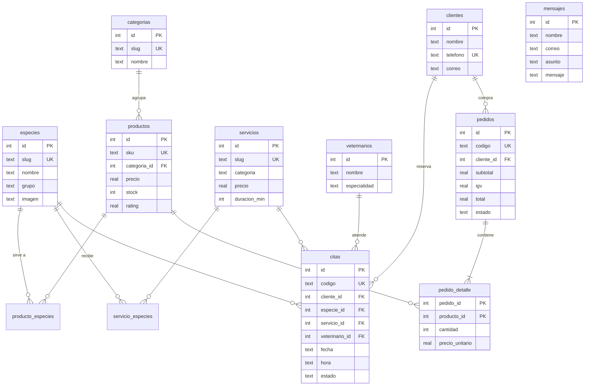

# Base de datos

El esquema completo está en `backend/src/db/schema.sql` y los datos iniciales en `backend/src/db/datos.js`. Al iniciar el backend por primera vez se crean las tablas y se cargan los datos.

## Diagrama entidad-relación



## Reglas que garantiza la propia base de datos

| Regla | Cómo |
|---|---|
| Un veterinario no tiene dos citas a la misma hora | `UNIQUE (veterinario_id, fecha, hora)` en `citas` |
| El stock nunca es negativo | `CHECK (stock >= 0)` en `productos` |
| Precios positivos y ratings entre 0 y 5 | `CHECK` en `productos` y `servicios` |
| Estados válidos | `CHECK (estado IN (...))` en `citas` y `pedidos` |
| Un cliente por celular | `UNIQUE (telefono)` en `clientes` |
| Un producto sirve a varias especies | Tabla intermedia `producto_especies` (muchos a muchos) |
| El pedido conserva el precio del momento | `pedido_detalle.precio_unitario` |

## Transacciones

`crearPedido` (en `modelos/pedidos.js`) crea el pedido, inserta el detalle y descuenta el stock **dentro de una transacción**. Si un producto no alcanza, se ejecuta `ROLLBACK` y no se guarda nada. Lo comprueba la prueba «pedidos: descuenta stock y la transacción se deshace si falta stock».

## Consultas útiles para el informe

```sql
-- Ventas por categoría
SELECT c.nombre, SUM(d.cantidad * d.precio_unitario) AS ventas
FROM pedido_detalle d
JOIN productos p ON p.id = d.producto_id
JOIN categorias c ON c.id = p.categoria_id
GROUP BY c.id ORDER BY ventas DESC;

-- Citas por veterinario en una fecha
SELECT v.nombre, COUNT(*) AS citas
FROM citas ci JOIN veterinarios v ON v.id = ci.veterinario_id
WHERE ci.fecha = '2026-10-24' AND ci.estado <> 'Cancelada'
GROUP BY v.id;

-- Productos con poco stock
SELECT sku, nombre, stock FROM productos WHERE stock <= 5 ORDER BY stock;
```

Para abrir la base y ejecutar estas consultas puedes usar [DB Browser for SQLite](https://sqlitebrowser.org/) con el archivo `backend/data/huellitavet.db`.

## Migrar a PostgreSQL (para producción)

El SQL es estándar, así que el cambio es acotado:

1. Crea una base gratuita en [Neon](https://neon.tech) o [Supabase](https://supabase.com) y copia la *connection string*.
2. En `backend`: `npm install pg`.
3. Ajusta `schema.sql`: `INTEGER PRIMARY KEY AUTOINCREMENT` → `SERIAL PRIMARY KEY`, `REAL` → `NUMERIC(10,2)`, `datetime('now')` → `NOW()` y quita los `PRAGMA`.
4. Reemplaza `db/conexion.js` por un `Pool` de `pg` y cambia los `?` de las consultas por `$1, $2…`.
5. En Vercel agrega la variable `DATABASE_URL`.

Los modelos son el único lugar con SQL: rutas y controladores no cambian.
